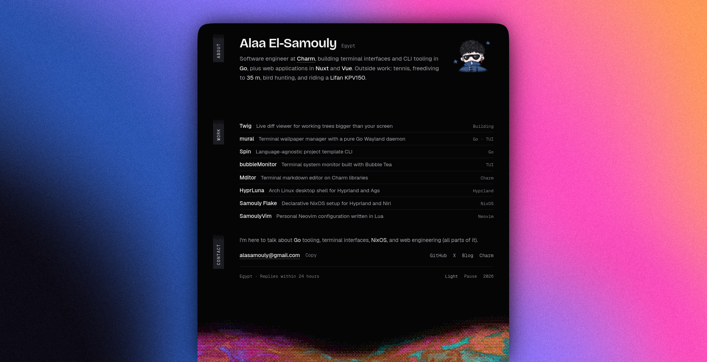

# portforio

My second personal site at [portforio.samouly.fun](https://portforio.samouly.fun).



## Stack

- Elm 0.19 (`Browser.document` + `elm-explorations/webgl`)
- Tailwind CSS v4
- Vite 8 (custom Elm plugin in `vite.config.js`)
- Custom WebGL2 `<grainient-bg>` element for the background shader

Most of the visuals are GPU shaders: a Bayer 8x8 dithered avatar (`src/DitherTop.elm`), an interactive dither wave footer (`src/DitherFooter.elm`), a Bayer dissolve mask for theme switches (`src/BayerMask.elm`), and the two-pass Grainient backdrop (`src/grainient.js`).

## Local development

Requires `elm` and `bun`.

```sh
bun install
bun run dev
```

Typecheck and build:

```sh
bun run check:elm
bun run build
```
